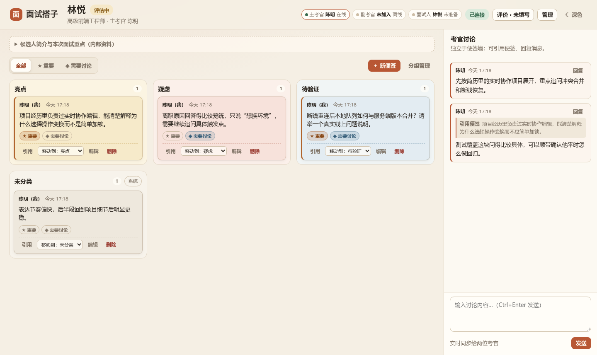
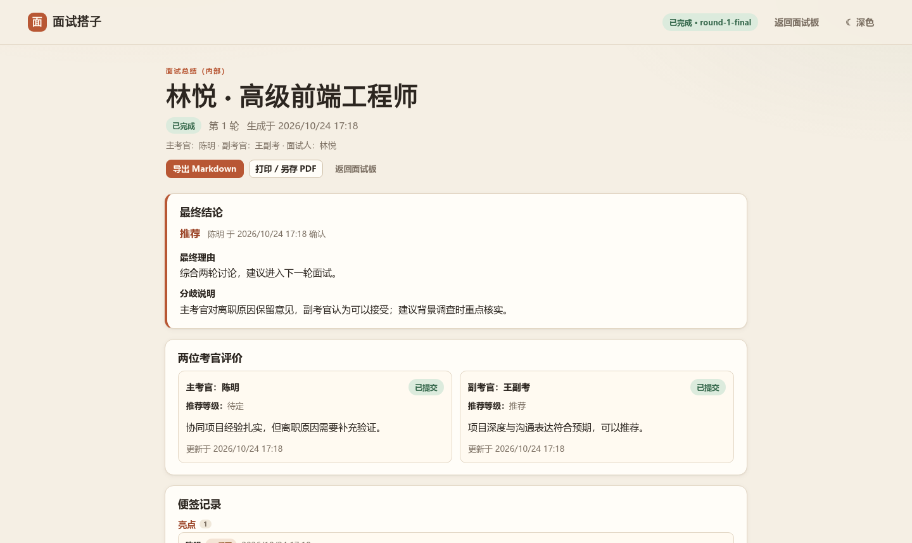

# 面试搭子（Interview Partner）

面向真实招聘面试的单场协作板：两位考官实时记录、独立讨论、分别评价，主考官确认最终结论并导出总结；面试人通过独立链接查看公开信息与结束状态。

本项目按 [`docs/project-plan.md`](docs/project-plan.md) 实施，是一个**本机单实例可运行 MVP**：

- Node.js 24 内置 `http` + 内置 `node:sqlite` + SSE，无第三方运行依赖；
- 三角色（主考官 / 副考官 / 面试人）为真实服务端权限隔离；
- 便签、分组、标记与讨论实时同步；
- 离线编辑写入 IndexedDB 队列，重连后按 `opId` 幂等同步，冲突转本地草稿；
- 浏览器完成业务操作，CLI 只负责本机启动与管理。

| 主考官面试板 | 面试总结 |
| --- | --- |
|  |  |

更多实测截图见 [`docs/screenshots/`](docs/screenshots/)，验收结果见 [`docs/verification.md`](docs/verification.md)。

## 环境要求

- Linux（当前实测环境：Linux 6.8 / x86_64）
- Node.js **24 或更高**（实测 v24.22.1，需内置 `node:sqlite`）
- 现代浏览器：Chrome（完整实测）；Firefox 可运行，但本轮未做完整验收
- 不需要 Docker、数据库服务、包管理器安装或外网

## 快速开始

```bash
cd /home/lyxy/Documents/traedemos
npm start
```

启动后浏览器访问 **http://127.0.0.1:4310**。

另开一个终端使用控制台：

```bash
npm run console          # 交互菜单
npm run console -- status
npm run console -- demo
```

首次启动会在 `data/` 自动创建：

| 文件 | 作用 | 权限 |
| --- | --- | --- |
| `data/interview.sqlite` | 面试、便签、评价、事件等全部业务数据 | 600 |
| `data/secrets.json` | 尚未兑换的邀请令牌原值 | 600 |
| `data/admin-token` | 本机 CLI 管理凭据 | 600 |
| `data/server-state.json` | 运行中的服务地址，进程退出时删除 | 600 |

数据库启用 WAL、外键与 schema 版本迁移；升级程序时只追加迁移，不覆盖已有数据。

## 三角色演示（推荐流程）

同一浏览器只能保持一个活动身份，因此演示需要三个独立浏览器环境：

1. 浏览器 A 打开首页，点击「创建示例面试」或填写表单创建空白面试。
2. 在结果页复制三个链接：
   - **主考官**：浏览器 A 打开，领取身份后进入面试板；
   - **副考官**：浏览器 B（无痕窗口）打开，填写姓名提交申请，等待审批；
   - **面试人**：浏览器 C（另一个浏览器或独立配置文件）打开，领取身份。
3. 回到浏览器 A 的面试板，点击「管理」→ 批准副考官申请；浏览器 B 会自动进入。
4. 主考官新建便签、设置标记、在右侧讨论并引用便签；副考官窗口会实时看到并可以移动便签、回复讨论。
5. 两位考官点击「评价」分别选择等级、填写理由并「正式提交」。
6. 主考官在「评价」面板点击「前往确认最终结论」，填写最终等级与理由；等级不一致时必须填写分歧说明。
7. 确认后面试板只读，可打开「查看总结」或导出 Markdown；面试人只看到「本次面试已结束」。
8. 主考官在「管理 → 最终结论」可重新开启，进入第 2 轮评估（历史结论保留，评价恢复为草稿）。

面试人页面只包含公开信息；内部简介、面试重点、便签、讨论、评价与最终结论不会出现在其快照、SSE 事件或 IndexedDB 缓存中。

## CLI 控制台

统一入口：`npm run console -- <command>`。无参数进入交互菜单，退出菜单不会关闭服务。

| 命令 | 说明 |
| --- | --- |
| `status` | 服务地址、端口、数据库路径、在线人数、已有面试 |
| `create` | 逐项询问创建空白面试；也可用 `--candidate --position --lead --brief --focus --public` 非交互创建 |
| `demo` | 用确定的虚构资料创建示例面试（仍走真实领取与审批） |
| `links <interview-id>` | 主考官标准入口与尚未领取的邀请链接 |
| `reinvite <id> --role co\|candidate\|lead --yes` | 重新邀请席位，撤销旧会话与旧实时连接 |
| `recover-lead <id> --yes` | 主考官身份丢失时生成新的恢复链接 |
| `report <id> [--output ./exports/report.md]` | 导出 Markdown；未完成时标注「评估中」 |
| `stop` | 停止本机服务（等价于服务终端 Ctrl+C） |
| `help` | 帮助 |

说明：

- 邀请令牌只在创建时显示一次，并保存在本机受保护状态文件中；兑换、撤销或过期后移除。
- 服务端日志不打印完整令牌（长路径段统一脱敏）。
- CLI 不直接写数据库，而是通过带 `data/admin-token` 鉴权的本机管理 API 操作；服务未运行时给出中文错误与非零退出码。
- `reinvite` / `recover-lead` 会立即撤销旧身份，命令行模式必须显式加 `--yes`。

## 配置

全部配置都有默认值，可用环境变量覆盖：

| 变量 | 默认 | 说明 |
| --- | --- | --- |
| `HOST` | `127.0.0.1` | 监听地址 |
| `PORT` | `4310` | 监听端口；被占用时明确报错，不静默切换 |
| `DATA_DIR` | `./data` | 数据库、凭据、状态文件目录 |
| `EXPORTS_DIR` | `./exports` | 报告导出目录 |
| `INVITE_TTL_HOURS` | `24` | 邀请链接有效期 |
| `SESSION_TTL_HOURS` | `720` | 登录会话有效期 |

示例：

```bash
PORT=4400 DATA_DIR=/tmp/interview-demo npm start
```

跨设备 / 局域网访问不在本期验收范围；`127.0.0.1` 链接不能发给另一台电脑使用。若未来监听非本机地址，需要先单独处理 HTTPS、凭据与网络安全。

## 离线编辑与冲突

- 便签新增/修改/移动/标记、分组管理、讨论消息会先写入 IndexedDB 队列，再按顺序同步。
- 断网时界面显示「离线 · 待同步 N」，便签带「待同步」标记；刷新或关闭页面后队列仍保留。
- 重连后按队列顺序重放；相同 `opId` 只生效一次；一条冲突不会阻塞整批其他操作。
- 被拒绝或冲突的正文会保留在「草稿」中，可查看、复制后重新提交。
- 正式提交评价、审批加入、确认结论、重新开启、面试人确认准备等操作必须在线完成。
- Service Worker 只缓存静态壳和访问过的页面，不缓存任何 API 响应；第一次访问且从未缓存过的页面不保证离线打开。

桌面浏览器 DevTools 的 Network → Offline 即可演示；恢复联网后自动重连同步。

## 权限与安全

- 会话使用强随机令牌哈希存库，浏览器只保存 `HttpOnly; SameSite=Lax` Cookie；前端不保存角色认证密钥。
- 每个角色使用独立一次性邀请链接；副考官必须由主考官审批，面试人链接独立。
- 所有内部数据接口先校验会话、面试归属与角色；面试人接口只返回公开投影。
- 变更请求校验 `Origin`/`Host` 与 JSON Content-Type；正文一律按纯文本渲染，配合 CSP 防止 HTML/脚本注入。
- 请求体上限 128 KiB；便签 4000 字、消息 2000 字、评价理由 4000 字。
- 席位被重新邀请时撤销旧会话、递增代次、关闭旧 SSE 连接；旧客户端队列锁定为本地草稿。
- 数据库、邀请令牌文件、管理凭据与导出报告均为当前用户可读写（目录 700 / 文件 600）。

## 测试与验收

```bash
npm test                      # 27 个自动化测试（权限、流程、同步、CLI）
npm start                     # 另开终端保持服务运行
node scripts/browser-verify.mjs
```

浏览器实测需要本机安装 Google Chrome。脚本会启动三个独立 Chrome 用户目录，完成三角色真实流程、实时协作、评价确认、报告、离线队列、冲突草稿、手机只读与深色主题检查，并把截图写入 `docs/screenshots/`。

最近一次实测结果（2026-10-24）：

- `npm test`：**27 / 27 通过**；
- 浏览器端到端：**全部通过**，便签实时同步实测约 **100 ms**（102–103 ms）；
- 面试人 `IndexedDB` 缓存经检查不含便签、评价或内部简介；
- 详细逐项结果与已知限制见 [`docs/verification.md`](docs/verification.md)。

## 目录结构

```text
traedemos/
  package.json
  README.md
  docs/
    project-plan.md          # 实施基线
    verification.md          # 实测结果与限制
    screenshots/             # 浏览器实测截图
  src/
    server.mjs               # 启动入口
    config.mjs
    secrets.mjs              # 本机保护文件（邀请令牌 / 管理凭据）
    db/                      # schema、迁移、事务、事件
    domain/                  # 认证邀请、权限、状态机、操作、评价、报告
    http/                    # 路由、静态资源、SSE、管理 API
    cli/                     # 命令与交互菜单
  public/
    index.html               # 创建面试
    join.html                # 邀请领取 / 副考官申请
    board.html               # 考官面试板
    candidate.html           # 面试人页面
    report.html              # 在线总结
    app/                     # 各页面控制器
    shared/                  # API、IndexedDB、同步引擎、主题、DOM
    styles/base.css
    sw.js                    # 静态壳缓存
  scripts/
    cdp.mjs                  # Chrome DevTools Protocol 小工具
    browser-verify.mjs       # 三角色浏览器实测
  tests/
  data/                      # 运行期数据（不纳入版本管理）
  exports/                   # 报告导出（不纳入版本管理）
```

## 数据备份与恢复

1. 停止服务（`npm run console -- stop` 或 Ctrl+C）。
2. 备份整个 `data/` 目录（数据库、WAL 文件、邀请与凭据文件需一起备份）。
3. 恢复时把 `data/` 放回项目目录，再启动服务；SQLite 会自动应用缺失的 schema 迁移。

不要在服务运行时只复制 `interview.sqlite` 而遗漏 `-wal`/`-shm`。

## 故障排查

| 现象 | 处理 |
| --- | --- |
| 端口被占用 | 关闭占用进程，或设置 `PORT` 后重新启动；不要同时开两个实例写同一数据库 |
| CLI 提示管理凭据无效 | 确认 `DATA_DIR`/`PORT` 与服务一致；在项目目录运行；必要时停止服务后删除 `data/admin-token` 再启动 |
| 浏览器链接打开无权限 | 邀请链接是一次性的；已领取的身份换浏览器/清 Cookie 后需 `reinvite` 或 `recover-lead` |
| 手机端不能编辑 | 这是产品设计：手机端只读；请改用电脑端 |
| 离线刷新后旧内容 | Service Worker 与 IndexedDB 的正常缓存；联网后自动刷新，「草稿」中可见未同步内容 |
| 报告还是「评估中」 | 两位考官都提交后，主考官还需在「管理 → 最终结论」确认 |

## 本期明确不做

候选人列表、岗位管理、账号注册与组织、跨场搜索、音视频会议、屏幕共享、在线笔试、AI 评分、消息附件、PDF 直接生成、考官与面试人聊天、公开招聘结论、多副考官、云部署及生产级高可用。

## 许可

内部演示项目，无外部依赖。
